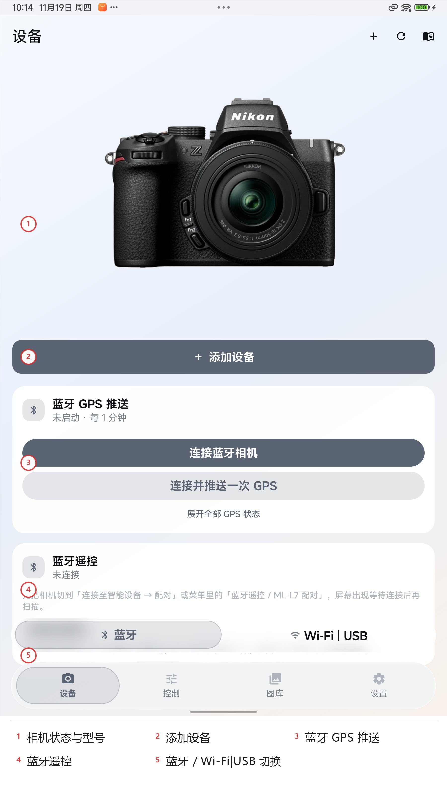
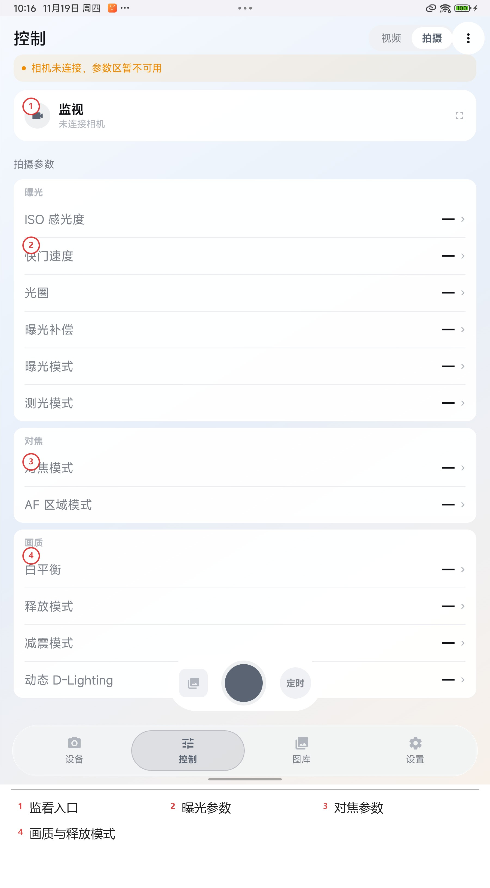
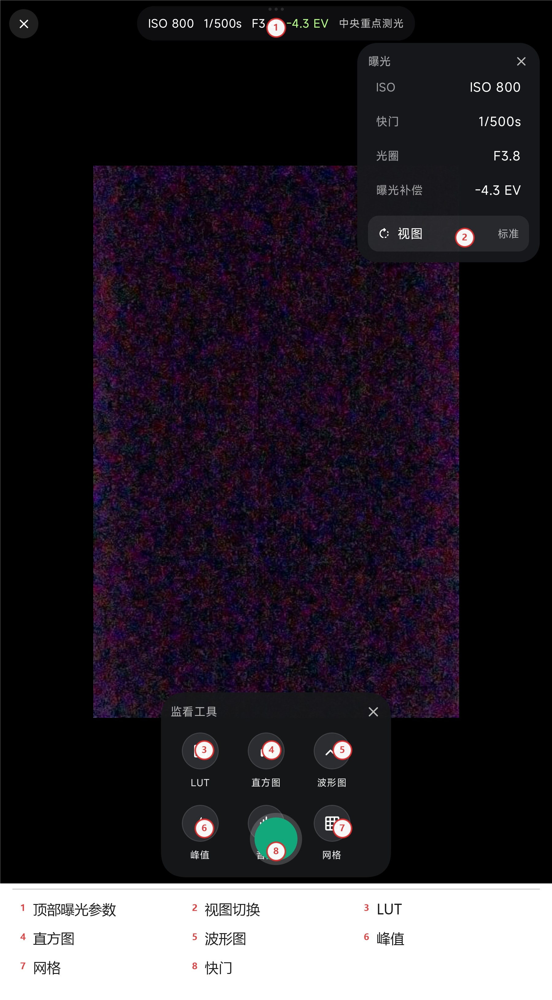
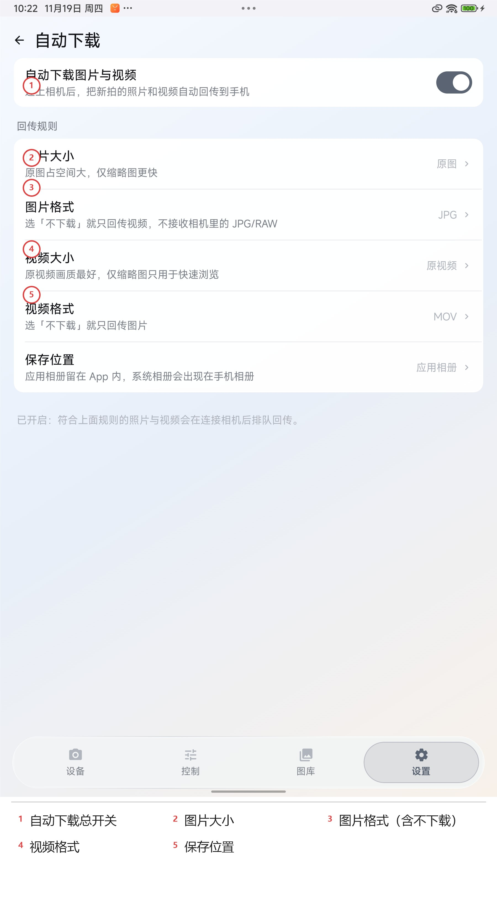

# 连镜

连镜是一款面向尼康相机的 Android 控制与监看工具：把手机或平板变成相机的无线监视器、参数控制台和图库入口。免费、无广告、无内购。

> 实机验证机型：Nikon Z50II。其他尼康机型按 PTP 通用能力适配，个别机型的菜单名称或能力开关可能不同，以相机实际菜单为准。

---

## 功能一览

- **Wi‑Fi / USB 连接**：连接尼康相机，读取机身状态、电池、存储与拍摄参数。
- **实时监看**：横屏全屏取景、曝光参数、LUT、直方图、波形图、相机声道、网格与预览画质三档。
- **监看侧栏**：左右两栏可自定义常用参数与开关，快门固定在右栏中间。
- **参数控制**：ISO、快门、光圈、曝光补偿、白平衡、对焦模式、AF 区域、释放模式、测光等。
- **图库与编辑**：查看相机照片、RAW/JPG 下载、裁剪、曲线、滤镜、LUT 与保存。
- **自动下载**：连接后自动回传新拍照片，支持 JPG / RAW，可选择原图或缩略图。
- **锁定文件导入**：识别相机内保护/锁定文件，支持 JPG、RAW 与视频分流导入。
- **蓝牙 GPS 推送**：把手机 GPS 写入相机，让照片保留拍摄位置。
- **蓝牙遥控**：连接尼康蓝牙遥控，释放快门、控制相机。
- **高级材质界面**：可调透明度与模糊度，适配横竖屏监看。

---

## 安装

1. 在 [Releases](https://github.com/4647luo/lianjing/releases) 下载最新的公开版，命名形如 `lianjing-0.2.6.apk`。
2. 在 Android 手机上允许「安装未知来源应用」。
3. 安装后打开 App，按首页提示授予存储/附近设备/位置权限。

系统要求：Android 10（API 29）及以上。

---

## 连接相机

### Wi‑Fi 连接

1. 相机菜单打开「连接至智能设备」→「Wi‑Fi 连接」。
2. 手机 Wi‑Fi 连接到相机热点（Z50II 默认名称类似 `Nikon_Z50II_...`）。
3. App「设备」页点「添加设备」，选择相机或输入相机 IP。
4. 连接成功后进入「控制」页，点「监看」打开实时画面。

### USB 连接

1. 用数据线连接相机与手机/平板。
2. 相机菜单把 USB 模式设为 `PTP` 或 `MTP/PTP`。
3. App 会自动识别 USB 设备，按提示授权后进入控制。

### 蓝牙连接

蓝牙用于 **GPS 推送** 和 **蓝牙遥控**，不是实时图传。

1. 相机菜单进入「连接至智能设备」→「配对」。
2. 在相机屏幕出现「等待连接」后，打开 App「设备」页 → 底部切到「蓝牙」。
3. 点「连接蓝牙相机」，选择相机名称（例如 `Z50_2_...`）。
4. 首次配对需要在系统蓝牙弹窗确认；如果一直连不上，先关闭再打开手机蓝牙，并确认相机仍停在配对页。
5. 连接成功后：
   - 「蓝牙 GPS 推送」可手动推送一次，或按 1 分钟周期推送。
   - 「蓝牙遥控」可释放快门、半按对焦（机型支持时）。

> 蓝牙 GPS 与 SnapBridge 会争抢相机连接，使用前先在 SnapBridge 里断开相机。

---

## 使用说明

### 1. 设备页



1. **相机状态与型号**：显示当前相机、固件与连接状态。
2. **添加设备**：添加 Wi‑Fi / USB 相机。
3. **蓝牙 GPS 推送**：连接蓝牙后把手机位置写入相机。
4. **蓝牙遥控**：连接后远程释放快门。
5. **蓝牙 / Wi‑Fi|USB 切换**：点「设备」标签一次显示切换条，再点一次收起；收起后保留上次选择。

右上角「+」添加设备，「刷新」重新扫描。

### 2. 控制页



1. **监看入口**：进入实时画面。
2. **曝光参数**：ISO、快门、光圈、曝光补偿、曝光模式、测光模式。
3. **对焦参数**：对焦模式、AF 区域模式。
4. **画质与释放模式**：白平衡、释放模式（单张/连拍/定时）、减震、动态 D‑Lighting。

顶部「拍摄 / 视频」切换拍照与视频参数组；右上角「更多」可打开定时、间隔等附加功能。参数卡支持长按拖动排序，也可以在设置里隐藏不用的项目。

### 3. 监看页



1. **顶部曝光参数**：ISO、快门、光圈、曝光补偿、测光模式，点一下可展开参数卡片。
2. **视图切换**：旋转视图、对称视图等显示方式。
3. **LUT**：载入设置里导入的 LUT。
4. **直方图**。
5. **波形图**。
6. **峰值**：手动对焦辅助。
7. **网格**：构图辅助线。
8. **快门**：拍照/录制。

监看页支持横竖屏。横屏时左右滑动打开工具面板，上滑打开监看工具（LUT、直方图、波形、峰值、音频），下滑打开相机参数（测光、对焦、文件类型、AF 等）。再点一下画面可收起工具。

### 4. 图库与编辑


1. **切换相册**：在「应用内」和「系统相册」之间切换。
2. **右上角更多**：选择、排序、批量下载等。
3. **照片 / RAW 网格**：JPG、RAW、PNG 会显示格式角标；点开直接查看大图。
4. **图库入口**：底部 Dock 栏。

图片编辑支持裁剪、旋转、曲线、滤镜、LUT、文字与保存；保存面板与工具栏都使用高级材质。

### 5. 自动下载与锁定文件



1. **自动下载总开关**：连接相机后自动回传新拍照片。
2. **图片大小**：原图或缩略图。
3. **图片格式**：`JPG` / `JPG + RAW` / `全部格式` / `不下载`。
4. **视频格式**：`MOV` / `MP4` / `不下载`。
5. **保存位置**：应用相册 / 系统相册 / Download。

设置 → 自动下载 → 下载保护文件：
- 「只下载锁定文件」是总开关，关闭后其他锁定选项置灰。
- 可选择「导入相机内所有锁定文件」或「仅导入连接后新增的锁定文件」。
- 「导入前询问」只对上面两种导入方式生效。
- JPG、RAW、视频会按各自格式设置分流；选择「不下载」的格式会被跳过。

> 视频自动回传默认不拉取超大文件，避免手机内存不足；大视频建议在图库里手动下载。

---

## 检查更新

App 内「设置 → 关于 → 检查更新」默认读取本仓库的 GitHub Releases，**不会打开浏览器**；检测到新版本后会直接在 App 内下载并调起系统安装器。

- **打开应用时检查更新**：可开关；开启后启动 App 自动检查一次，24 小时内不重复请求，失败静默。
- **更新源**：可选「GitHub 官方」或「网盘直链」。
- **GitHub 官方**：读取 Release 的 tag、正文和 `.apk` 附件。
- **网盘直链**：支持 JSON 更新清单，也支持直接填 `.apk` 直链。
- **百度网盘分享链接**：分享页需要登录，App 不会强行读取；会直接显示分享链接和「打开百度网盘分享链接」按钮，由用户打开后下载安装包。
- **百度网盘备用下载**：更新页固定显示入口，GitHub 连不上时可用。当前文件夹分享（永久有效）：
  `https://pan.baidu.com/share/init?surl=BIIX6VP7PJxVjlgmYiCwzw&pwd=lk01`，提取码 `lk01`。
  后续每次发版把同版本 APK 放进 `/LensLink` 文件夹即可，分享链接不变。

网盘 JSON 清单示例：

```json
{
  "version": "0.1.0",
  "apkUrl": "https://example.com/lianjing-0.1.0.apk",
  "notes": "更新说明",
  "apkSize": 48968000
}
```

发布新版本时：

1. 修改 `app/build.gradle.kts` 的 `versionCode` 和 `versionName`。
2. 用固定 keystore 构建 release APK。
3. GitHub 更新源：创建 tag（如 `v0.1.0`）并发布 Release，把 APK 作为附件。
4. 网盘更新源：上传 APK，写好 JSON 清单并填到「网盘链接」；如果用百度分享链接，App 会显示打开按钮，不会自动比较版本。

---

## 权限说明

- **网络 / Wi‑Fi**：连接相机热点与 PTP。
- **附近设备 / 蓝牙**：蓝牙 GPS 与蓝牙遥控。
- **位置**：Android 扫描蓝牙设备所需；同时用于 GPS 推送。
- **存储 / 照片与视频**：保存回传照片、锁定文件与编辑结果。
- **USB**：通过 USB 连接相机。

App 不上传照片到任何服务器；GitHub 更新检查只请求公开的 Release 信息，网盘更新只读取你填写的公开清单或直链。

---

## 常见问题

**连不上相机？**
- 确认手机连的是相机热点，不是家用 Wi‑Fi。
- 相机热点下部分手机提示「无互联网」，选择「保持连接」。
- USB 连接时确认相机 USB 模式是 PTP。

**蓝牙 GPS 一直显示正在连接？**
- 相机要停在「连接至智能设备 → 配对」页面。
- 关闭再打开手机蓝牙后重试。
- 断开 SnapBridge 等其他相机 App。

**自动下载没有反应？**
- 确认「设置 → 自动下载」总开关开启，图片格式不是「不下载」。
- 相机拍的是 JPG 或 RAW；视频不会自动拉取。
- 连接后拍一张新照片，旧照片不会自动补传。

**锁定文件导入不到？**
- 先在相机里给照片加保护/锁定。
- 确认总开关开启，且格式设置包含该文件类型。
- 「仅连接后新增」只抓连接后新加锁的文件；要导入机身已有全部锁定文件，请切换到「相机内所有锁定文件」。

---

## 版本号规则

- **本地修改版**：`0.0.N`，最后一位每次本地构建递增，例如 `0.0.123`、`0.0.124`。这一版只在自己设备上测试，不对外发布。
- **公开版**：上传 GitHub / 百度网盘时只进第二位，写成 `0.1.0`、`0.2.0`、`0.3.0`，每次公开加 1。
- `versionCode` 每次构建都递增，保证覆盖安装不会回退。

> `0.1.0`、`0.1.1`、`0.1.2` 是切换到本规则前的本地构建编号，均未上传。

---

## 版本

### 0.1.0

优化了一些bug。

### 0.0.1

首个公开版本，包含 Wi‑Fi / USB / 蓝牙连接、实时监看、参数控制、图库编辑、自动下载、锁定文件导入、蓝牙 GPS 与 GitHub 更新检查。

---

## 支持作者

连镜由一个人维护，免费、无广告、无内购。如果它帮你省了时间，可以扫码请作者喝杯咖啡。赞赏完全自愿，不影响任何功能。

应用内「设置 → 支持作者」可查看赞赏码。也可在 GitHub 上给项目点一个 Star。

<p align="center">
  
</p>

<p align="center">感谢每一位使用和反馈的尼康用户。</p>

---

## 声明

连镜是一款**非官方**的第三方应用，与尼康株式会社（Nikon Corporation）**没有任何关联、隶属、授权、赞助或背书关系**。文中出现的相机型号与品牌名称仅用于说明兼容性，不代表尼康官方认可。

本软件按"现状"提供，不附带任何明示或暗示的保证。相机控制依赖厂商未公开的 PTP/IP 与蓝牙协议，不保证兼容所有机型、固件或后续固件更新；不同机型可用功能可能不同，部分操作可能导致拍摄中断、参数被修改、文件丢失或相机异常。使用本软件连接、控制相机及回传文件的风险由使用者自行承担；建议先在非重要拍摄场景测试，并保留原始文件备份。是否影响厂商保修，请以厂商条款为准。

应用不内置任何第三方 LUT，LUT 均由用户自行导入，导入文件的许可与合规性由用户自行确认。

本软件不会把照片上传到任何服务器；图库、自动下载与锁定文件均在本机处理。更新检查只读取公开的 GitHub Release 信息，或你填写的网盘清单/直链。

使用前请确认你拥有所连接相机的合法使用权，并遵守当地法律法规。如果你不同意上述说明，请不要使用本软件。
