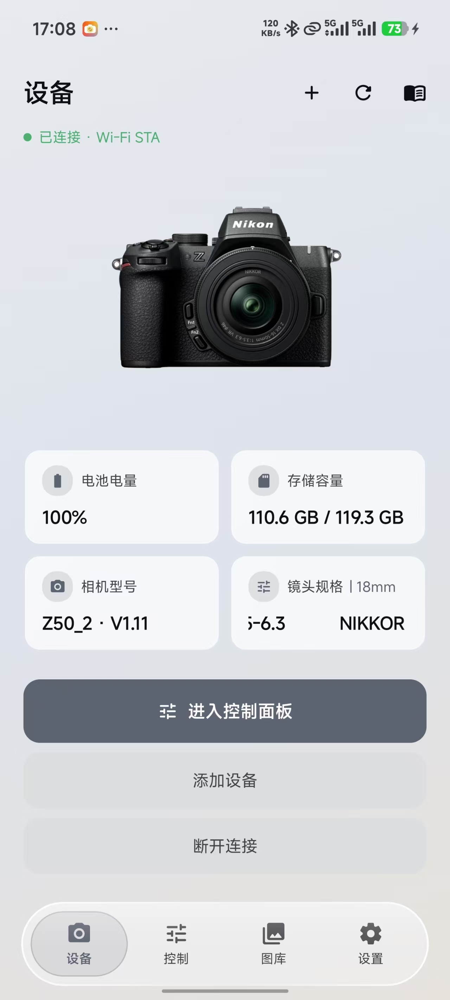
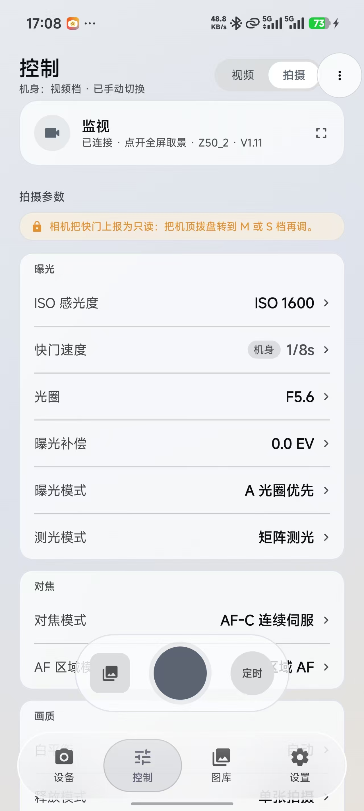
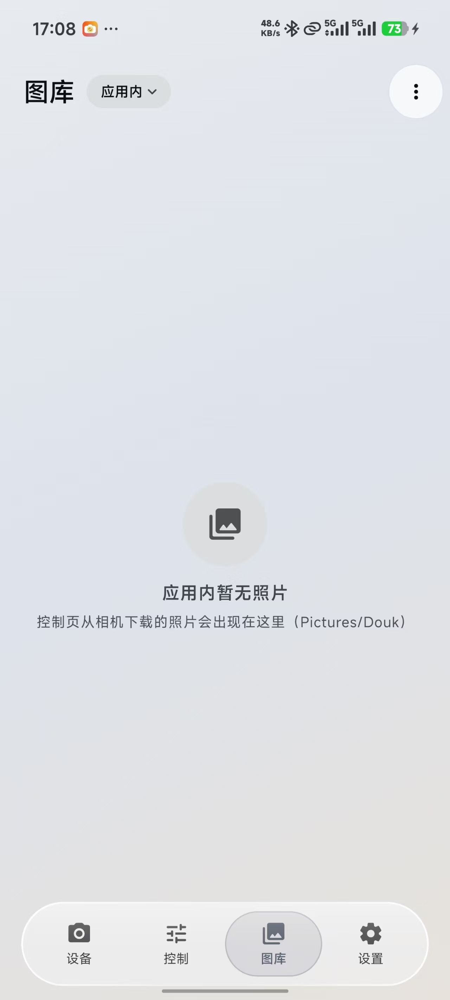
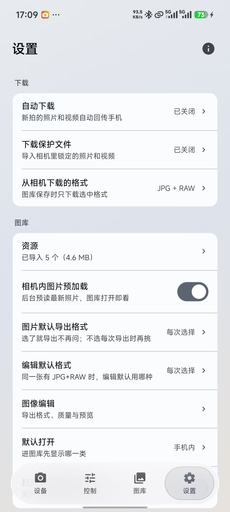
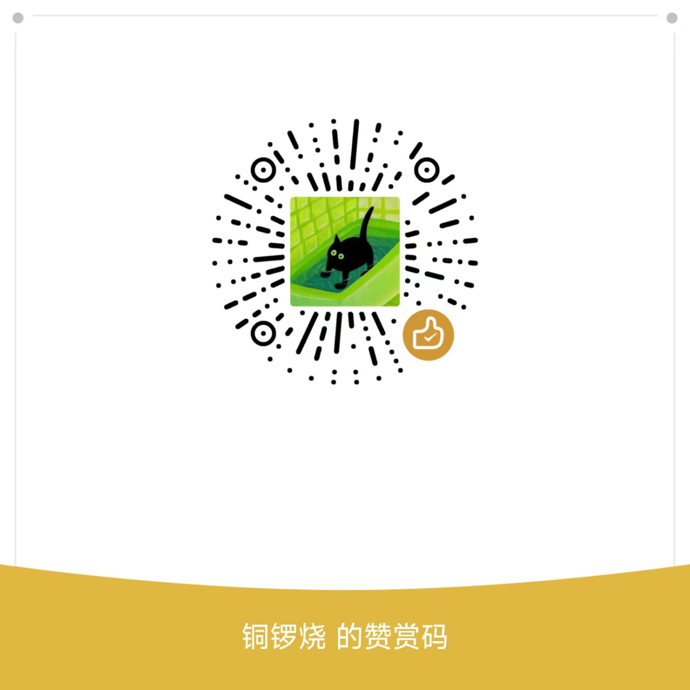

# 连镜

连镜是一款 Android 端的第三方尼康相机控制工具：把手机或平板变成相机的无线监视器、参数控制台和照片回传入口。支持 Wi‑Fi、USB 与蓝牙，照片只在本机处理，不上传服务器。免费、无广告、无内购。

> **非官方声明**：连镜与尼康株式会社（Nikon Corporation）没有任何隶属、授权、赞助或背书关系。文中的 Nikon、NIKKOR、Z50II 等名称仅用于说明兼容性，相关商标归其权利人所有。界面中的相机照片由用户自行设置，不代表尼康官方素材。

> 实机验证机型：Nikon Z50II。其他尼康机型按 PTP 通用能力适配，个别机型的菜单名称或能力开关可能不同，以相机实际菜单为准。

---

## 界面

| 设备页 | 控制页 |
| --- | --- |
|  |  |
| **图库** | **设置** |
|  |  |

---

## 主要功能

- **连接**：Wi‑Fi（相机热点 / STA）、USB PTP、蓝牙 GPS 与蓝牙遥控。
- **设备状态**：电量、存储、机型、固件、镜头信息与连接方式。
- **拍摄控制**：ISO、快门、光圈、曝光补偿、曝光模式、测光、白平衡、对焦模式与 AF 区域。
- **实时监看**：全屏取景、LUT、直方图、波形图、峰值对焦、网格与画面旋转。
- **图库**：应用内图库与系统相册切换，JPG / RAW 查看，多选、删除、下载与详情。
- **图片编辑**：裁剪、旋转、曲线、滤镜、LUT、文字与导出；支持普通图和 HDR 图。
- **自动回传**：连接后自动下载新照片，支持 JPG / RAW、原图或缩略图。
- **锁定文件导入**：识别相机内受保护文件，按 JPG、RAW、视频分流导入。
- **界面**：可调主题色、深色模式、玻璃质感与悬浮底栏。

---

## 安装

1. 在 [Releases](https://github.com/4647luo/lianjing/releases/latest) 下载 `lianjing-1.0.0.apk`。
2. 在 Android 手机上允许「安装未知来源应用」。
3. 安装后打开连镜，按提示授予照片、附近设备、定位等权限。

系统要求：Android 10（API 29）及以上。

如果 GitHub 下载慢，可使用百度网盘备用入口：

- 分享页：`https://pan.baidu.com/share/init?surl=BIIX6VP7PJxVjlgmYiCwzw&pwd=lk01`
- 提取码：`lk01`
- 目录：`/连镜`

---

## 使用流程

### 1. 首次打开

首次启动先看「设备」页。没有连接相机时，页面只显示添加设备入口；授予权限后再进行扫描或手动输入地址。

建议先确认三件事：

1. 手机剩余空间足够存放要回传的照片和视频。
2. 相机固件与手机系统都处于正常状态，存储卡没有写保护。
3. 如果相机正在被 SnapBridge 等其他应用连接，先在那里断开。

### 2. 连接相机

#### Wi‑Fi

1. 相机菜单打开「连接至智能设备」→「Wi‑Fi 连接」。
2. 手机 Wi‑Fi 连接到相机热点（Z50II 默认名称通常以 `Nikon_Z50II` 开头）。
3. 回到连镜「设备」页，点「添加设备」；自动扫描不到时，手动输入相机地址（常见为 `192.168.1.1`）。
4. 连接成功后，设备页会显示连接方式、机型、固件、电量、存储与镜头信息。

> 相机热点没有互联网时，系统可能提示「无互联网连接」。选择保持连接，不要自动切回家用 Wi‑Fi。

#### USB

1. 用数据线连接相机与手机 / 平板。
2. 相机菜单把 USB 模式设为 `PTP` 或 `MTP/PTP`。
3. 连镜识别到 USB 设备后按提示授权，再进入控制页。

#### 蓝牙

蓝牙主要用于 **GPS 推送** 和 **遥控快门**，不传输实时画面。

1. 相机进入「连接至智能设备」→「配对」。
2. 相机屏幕出现等待连接后，打开连镜设备页，切到「蓝牙」。
3. 点「连接蓝牙相机」，选择相机名称（例如 `Z50_2_...`）。
4. 首次配对在系统蓝牙弹窗确认；连不上时先关闭再打开手机蓝牙，并确认相机仍停在配对页。

### 3. 设备页

设备页是连接后的总览：

- 顶部状态条显示「已连接」和当前通道（Wi‑Fi STA / USB / 蓝牙）。
- 相机图与型号区域用于确认当前机身；图片可在设置里自行更换。
- 电量、存储、机型固件、镜头规格四张卡片直接读取相机状态。
- 「进入控制面板」进入拍摄参数页；「添加设备」用于再添加一台相机；「断开连接」释放当前相机。
- 右上角「+」添加设备，刷新按钮重新扫描，日志按钮进入运行日志。

### 4. 控制与监看

控制页分「拍摄」和「视频」两套参数：

- 曝光区：ISO、快门、光圈、曝光补偿、曝光模式、测光模式。
- 对焦区：对焦模式、AF 区域模式；部分机型支持点画面直接对焦。
- 画质区：白平衡、释放模式、减震、动态 D‑Lighting 等。
- 顶部「监视」卡片点开后进入全屏取景；右上角「更多」可打开定时、间隔等附加功能。

监看时：

- 横屏左右滑动打开工具面板，上滑打开 LUT、直方图、波形、峰值与音频工具，下滑打开相机参数。
- 点画面一次收起工具；需要手动对焦时可打开峰值辅助。
- 相机把某些参数上报为只读时，按页面提示把机身拨盘转到 M 或 S 档后再调。
- 监看默认不接管相机屏幕；需要时在相机参数里手动点「接管相机」。

### 5. 图库与编辑

图库有两个来源：

- **应用内**：连镜下载和回传的照片，默认保存在 `Pictures/连镜`；系统相册可见的备份在 `DCIM/连镜`。
- **系统相册**：手机里已有的照片和视频。

常用操作：

1. 点右上角「更多」进入选择、排序、批量下载和删除。
2. JPG、RAW、PNG 会显示格式角标；同一张 JPG+RAW 会合并成一格。
3. 点开照片查看大图、EXIF 和 HDR 信息；左右滑动切换。
4. 编辑支持裁剪、旋转、曲线、滤镜、LUT、文字与导出；导出格式可在设置里固定，也可以每次询问。
5. 删除应用内照片会同时删除对应的 JPG/RAW 配对文件；相机存储卡和系统相册原图不受影响。

> 1.0.0 会继续读取旧版 `Pictures/Douk`、`DCIM/Douk`、`DCIM/LensLink` 和 `LutCameraPro` 目录里的照片，升级后不会从应用图库消失；新照片只写入「连镜」目录。

### 6. 设置与维护

- **自动下载**：新拍照片和视频自动回传；可限制格式、大小与保存位置。
- **下载保护文件**：导入相机里已锁定的照片和视频，可选择全部导入或只导入连接后新增的文件。
- **资源**：导入自己的 `.cube` LUT 与 `.xmp` 滤镜；连镜不内置任何第三方 LUT。
- **图库**：默认打开来源、相机图片预加载、默认导出格式、编辑默认格式。
- **外观**：深色模式、主题色、玻璃质感、悬浮底栏。
- **关于**：检查更新、更新日志、条款、反馈与运行日志。

预设导出会把设置和 LUT 原文件打包成 zip。1.0.0 导出格式为 `lianjing-preset-v1`；旧版 `lenslink-preset-v1` 预设仍可直接导入，不需要重新制作。

---

## 文件与隐私

- 回传照片默认写入 `Pictures/连镜`；选择系统相册时写入 `DCIM/连镜`。
- 日志导出到 `Download/连镜`。
- 应用不收集、不上传照片、相机序列号、位置或使用记录，也不包含统计埋点和推广 SDK。
- 更新检查只读取公开的 GitHub Release 信息；网盘更新只读取公开分享页或你填写的清单/直链。

---

## 更新与反馈

- GitHub Release：`https://github.com/4647luo/lianjing/releases`
- 百度网盘：`https://pan.baidu.com/share/init?surl=BIIX6VP7PJxVjlgmYiCwzw&pwd=lk01`，提取码 `lk01`
- 应用内「设置 → 关于 → 检查更新」可直接检查并下载新版本。
- 反馈邮箱：`lianjingup@outlook.com`

---

## 版本 1.0.0

这是连镜的第一个正式版本。

- 应用名、安装包与保存目录统一为「连镜」。

---

## 支持作者

连镜由一个人维护，免费、无广告、无内购。如果它帮你省了时间，可以扫码请作者喝杯咖啡。赞赏完全自愿，不影响任何功能，也不代表购买服务。

  

也可以在 GitHub 上给项目点一个 Star。

---

## 声明

连镜是一款**非官方**的第三方应用，与尼康株式会社（Nikon Corporation）**没有任何关联、隶属、授权、赞助或背书关系**。Nikon、NIKKOR 等商标归其权利人所有，文中仅用于说明兼容性。

本软件按「现状」提供，不附带任何明示或暗示的保证。相机控制依赖厂商未公开的 PTP/IP 与蓝牙协议，不保证兼容所有机型、固件或后续固件更新；部分操作可能导致拍摄中断、参数被修改、文件传输不完整或相机异常。使用本软件连接、控制相机及回传文件的风险由使用者自行承担；建议先在非重要拍摄场景测试，并保留相机存储卡内的原始文件。

应用不内置任何第三方 LUT，LUT 均由用户自行导入，导入文件的许可与合规性由用户自行确认。

本软件不会把照片上传到任何服务器；图库、自动下载与锁定文件均在本机处理。更新检查只读取公开的 GitHub Release 信息。

使用前请确认你拥有所连接相机的合法使用权，并遵守当地法律法规。如果你不同意上述说明，请不要使用本软件。
